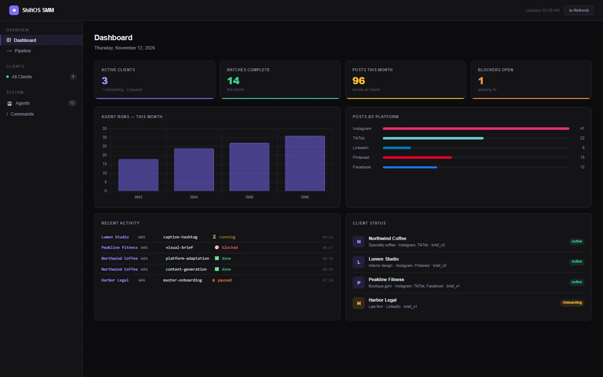
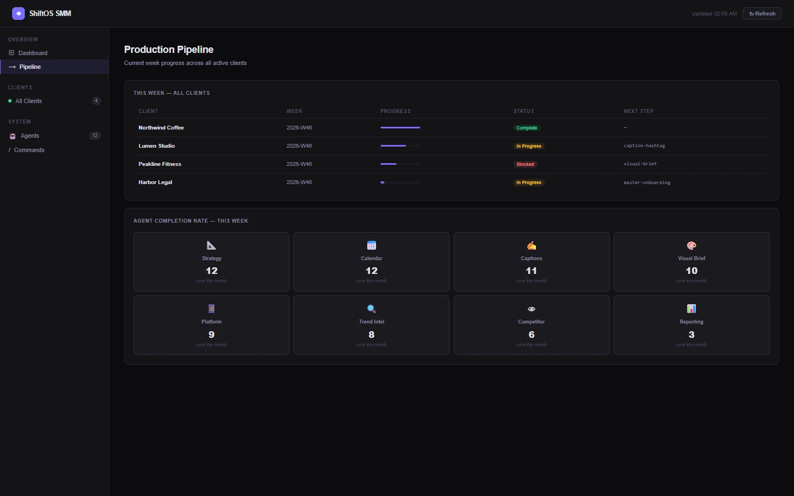
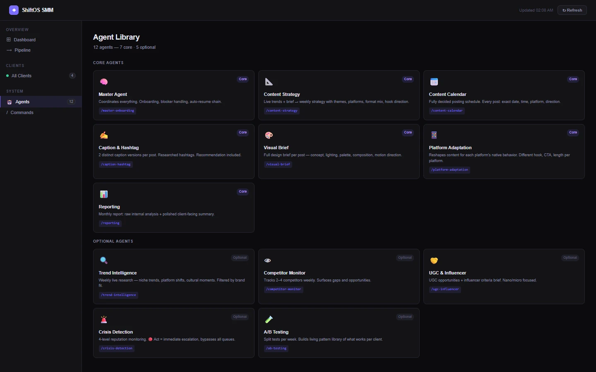
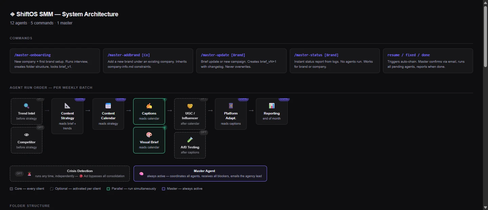
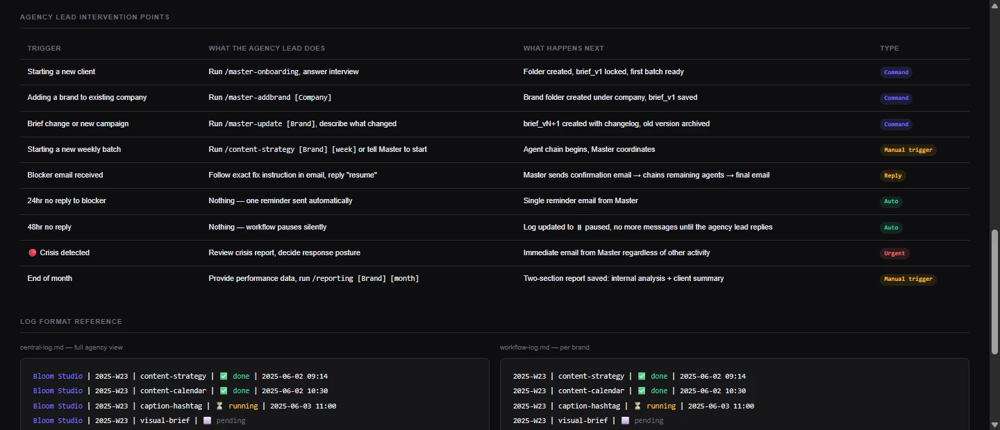
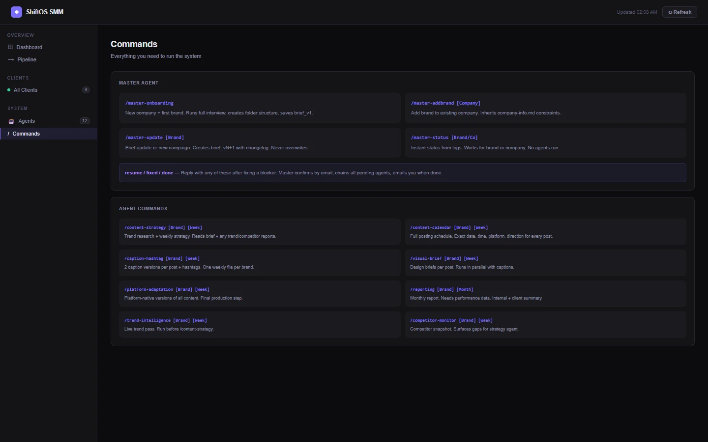

# ShiftOS SMM · Product Demo

Content operations system for social media agencies. A coordinating Master agent interviews the agency about each client, writes a versioned brief, then runs a chain of specialist agents every week: trend research, strategy, posting calendar, captions and hashtags, design briefs, image generation, platform-specific versions and a monthly report. The agency lead only steps in to answer the onboarding interview, approve a new campaign or fix a blocker.

> **Showcase only.** This repository contains screenshots and a description, **no source code**. The product is proprietary and closed-source. Every client shown below (Northwind Coffee, Lumen Studio, Peakline Fitness, Harbor Legal) is an **invented sample**; no real agency, brand or campaign data appears anywhere.

## The screens

### Dashboard
Active clients, completed weekly batches, posts this month and open blockers, with agent activity per week, output per platform, a live activity log and the status of every client.

### Production pipeline
This week's batch for every client: progress, whether it is blocked, and which agent runs next. Below it, how often each agent ran this month.

### Agent library
Seven core agents run for every client; five optional agents (trend intelligence, competitor monitoring, UGC and influencer briefs, crisis detection, A/B testing) are switched on per client in the brief.

### Agent run order
The weekly chain. Research agents feed strategy, strategy feeds the calendar, captions and visual briefs run in parallel, and platform adaptation produces the final per-platform versions. Crisis detection runs independently and can interrupt at any time.

### Where a person steps in
Everything else runs on its own. Blockers from any agent are collected by the Master agent into one message with the exact fix; a reply of "resume" restarts every pending agent. Unanswered blockers get one reminder, then the client's workflow pauses rather than guessing.

### Commands
The full command set for onboarding, brief updates, status checks and running individual agents.

## How it is built

- **Company → brand hierarchy:** multi-brand clients share one company record (legal and owner details); each brand keeps its own brief and production history.
- **Versioned briefs:** a change never overwrites a brief; it creates the next version with a changelog, and every agent always reads the latest.
- **Protected output:** agents check before writing and never silently overwrite earlier work.
- **One point of contact:** specialist agents never message the agency directly; all blockers go through the Master agent.
- **Two logs:** a detailed per-brand workflow log and one central log across the whole agency, which also feeds the dashboard.
- **Same design, any runner:** the agent definitions and file structure are independent of where they run, so the system moves from on-demand runs to a scheduled server without changes to the agents.

## Status

The agent system and dashboard are complete and run on demand. A server-hosted version that runs batches on a schedule is next.

## Contact

Built by **[Softburn.tech](https://softburn.tech)**.
